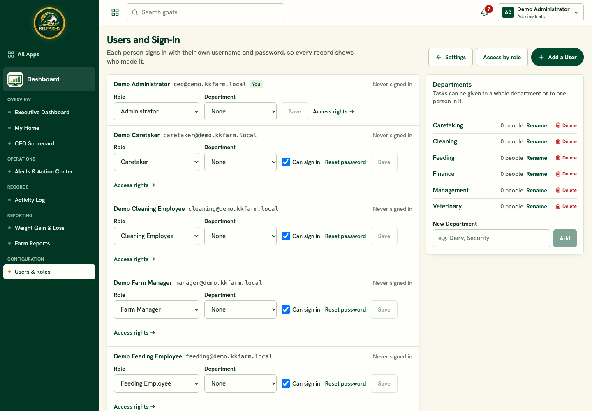
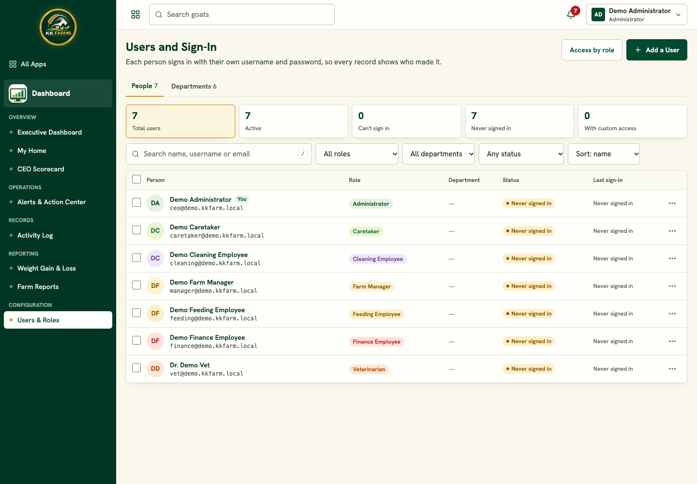
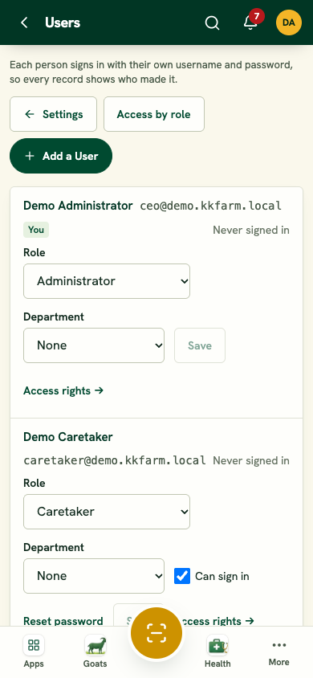
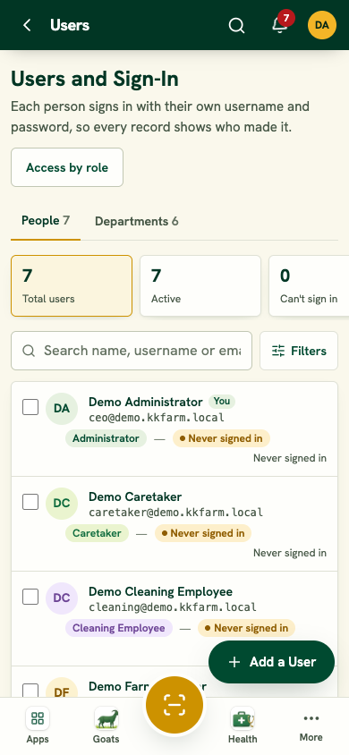
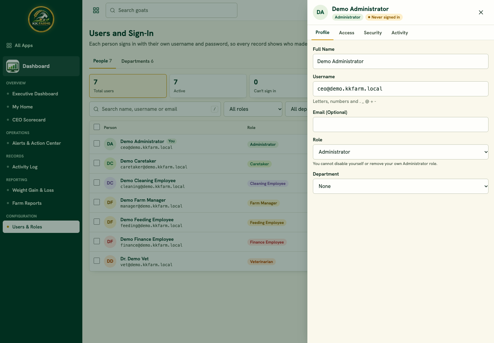
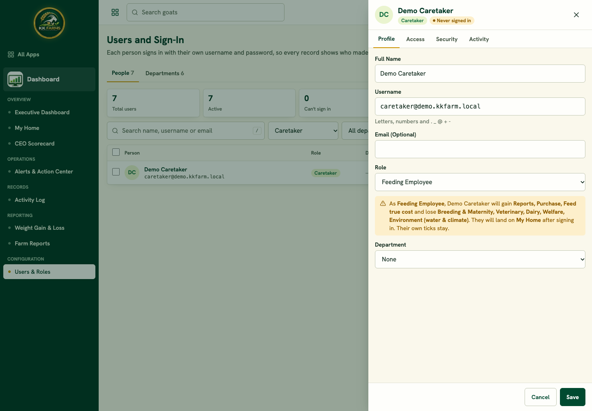
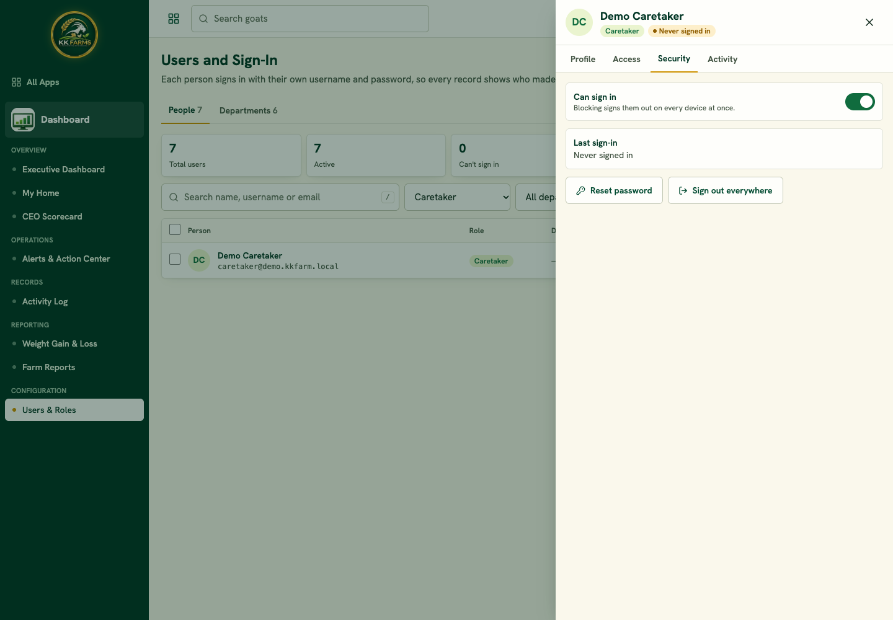
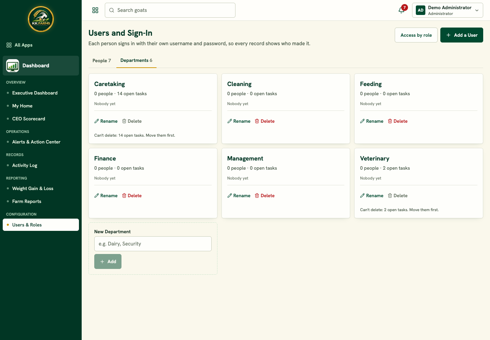
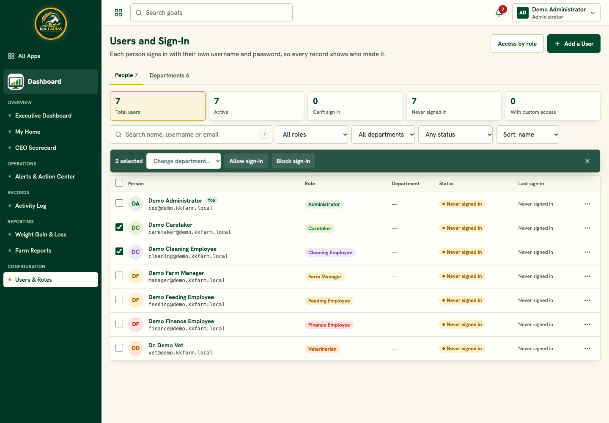
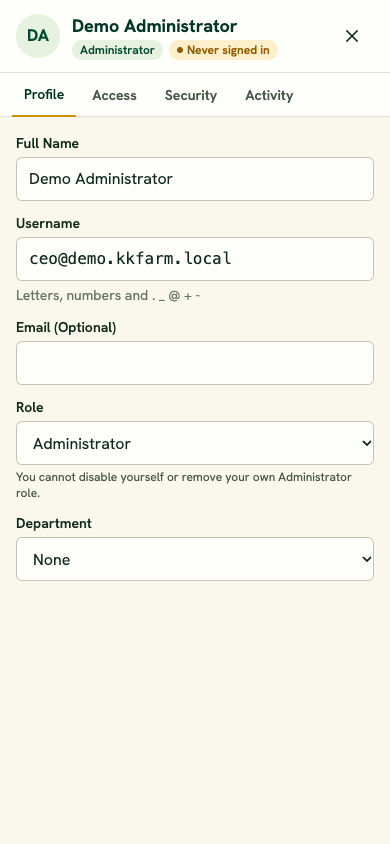

# D-244: Users and Sign-In redesigned

Settings → Users and Sign-In (`/settings/users`), Administrator only (page and every API call). Screens below use the local demo accounts.

## Before → after

| Before | After |
|---|---|
|  |  |
|  |  |

Drawer (Profile), role-change preview, Security, Departments tab, bulk bar, phone drawer:

## What changed

- **One compact list** (one row per person, no dropdowns or Save buttons in rows): avatar, name with the username shown once (and email if set), role badge (colour + text), department chip, status pill (Active / Disabled / Never signed in), last sign-in as "2 hours ago" with the exact time on hover, **Custom access** badge, and a row menu. On a phone the rows become cards.
- **Summary strip** (Total, Active, Can't sign in, Never signed in, With custom access) doubles as filters. **Search** (name, username, email), role, department, status and sort; all kept in the address so a filtered list can be shared. The server filters, so the counts and the list always agree. Phone: filters in a bottom sheet, a floating **Add a User** button.
- **Drawer** (right side; full screen on a phone): **Profile** (name, username with instant "Available / Taken", email, role, department; Save and Cancel appear only when something changed; changing the role shows "will gain / lose" and the home page they will land on), **Access** (apps, actions, pages open, what differs from the role, link to Access rights), **Security** (Can sign in switch, last sign-in, Reset password, Sign out everywhere), **Activity** (their last 20 actions). Esc closes; closing with unsaved changes asks first.
- **Reset password**: confirm → a temporary password is generated on the server, shown **once** with Copy, the person is signed out everywhere and must choose their own at the next sign-in. The password is never logged or shown again.
- **Blocking sign-in** asks first and signs the person out on every device at once.
- **Bulk**: tick several people to change department or allow/block sign-in, with **Undo** in the toast. Role changes stay one person at a time (they need the preview).
- **Departments** is a tab: a card per department with member avatars, people and open-task counts, Rename, Delete (refused with the reason while it has people or open tasks), and New department.
- **Guards** (server, whatever the screen sends): never yourself, never the last active Administrator; the locked controls say why.
- **Audit**: every change (role, username, name, email, department, sign-in, password reset, sign-out, new user, department added / renamed / deleted) is in the Activity Log as a security entry (Administrator only) with old → new.
- **No secrets** in the page or its JSON: no password hashes, tokens or per-user access JSON.
- New column `users.contact_email` (username stays in `users.email`). Usernames are now unique whatever the letter case.
- Keyboard: `/` searches, ↑ ↓ move between rows, Enter opens, Esc closes. Strings sit in one table (`T`) ready for Urdu; spacing uses start/end so the layout mirrors for right-to-left.

## Tests

`tests/Feature/UsersPageTest.php` (7): filters, search and summary counts; Administrator-only page and API with no secrets in the payload; self and last-Administrator guards through the screen's own calls and direct calls (including bulk); profile edit, unique username, role-change preview data; password reset shown once, forced change at sign-in, signed out everywhere, not in the log; bulk department and sign-in with sign-out; department delete refused with people or open tasks. Full suite **320 / 320**.
